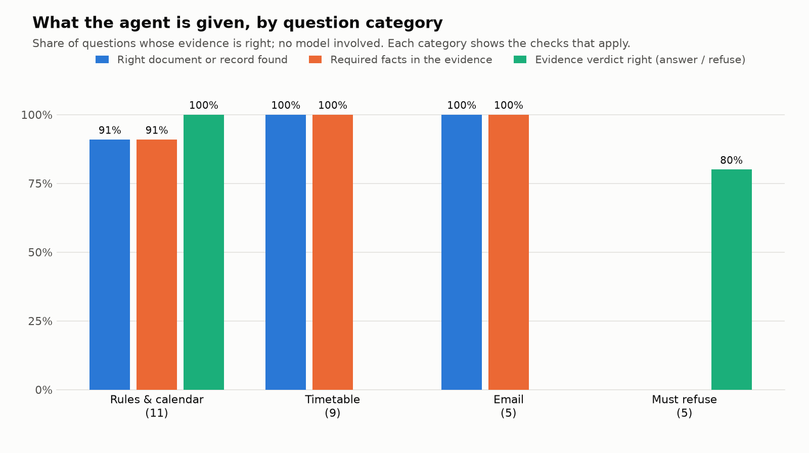
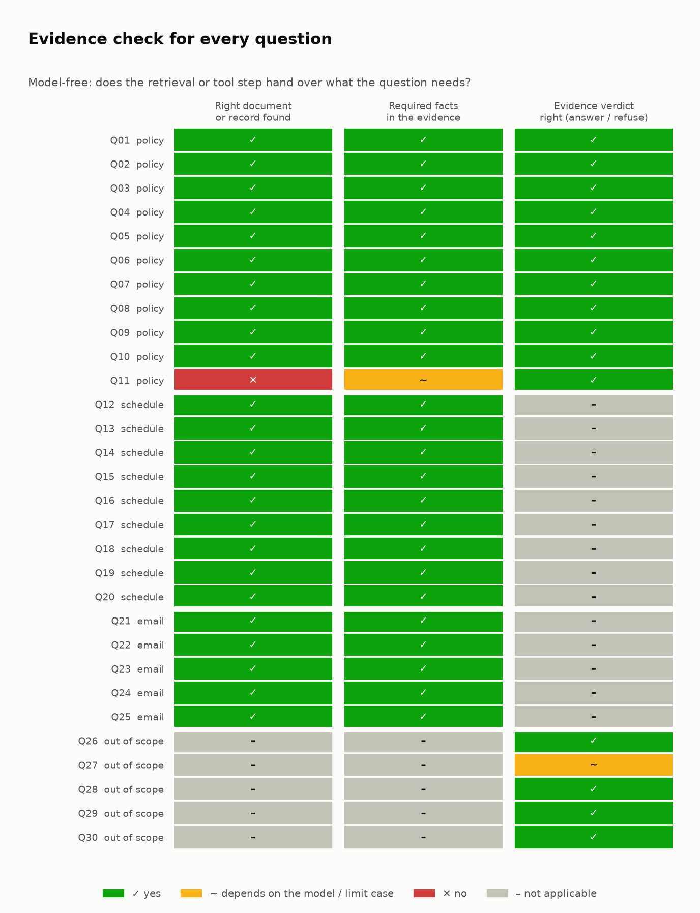

# Multi-Agent Academic Helpdesk Agent: Report

**Course:** Autonomous Systems · **System:** Google ADK multi-agent helpdesk over a RAG corpus of real IIT Jodhpur documents, chat model served by Groq through LiteLLM

> **What this report measures, and what it does not.** Everything in Sections 5 and 7 was measured by running the system's own code. The retrieval and tool layers are evaluated on all 30 questions without a chat model (Section 7.1). The **model's own answers were not scored on the full 30-question set**: that run is slow on a free tier and was stopped before it produced results. Section 7.2 therefore reports only what was actually observed (four real answers), and Section 7.3 gives the command that produces the full model scores. No model accuracy figure in this report is estimated.

## 1. Problem and scope

The helpdesk answers student questions about academic programmes, course content, rules and regulations, the timetable and course offerings, and drafts emails to course instructors (sick leave, make-up examination, attendance condonation). Anything else it must refuse rather than guess, and log for a human.

The hard part is not answering; it is **not** answering. A helpful model will happily invent an attendance threshold, an instructor's email address, or a count of electives. The engineering below exists to make those failure modes impossible rather than unlikely: counts and contacts come from code, every answer must cite a document, and refusal is driven by evidence.

## 2. Data

**Documents (RAG).** 33 real Institute documents, embedded as 390 chunks with ChromaDB's bundled all-MiniLM-L6-v2 (384 dimensions): academic regulations (UG 2019, PG 2022, M.S. by Research 2023), circulars and amendments (attendance and examination policy, July 2024), the 2026-27 academic calendar and summer calendar, the fee structure, B.Tech. curricula (CSE, EE, ME, AI&DS), the Humanities course list, placement and internship policy, scholarships, and forms. Chunks carry `doc_id`, title, category, page range and, for amendments, which regulations they supersede and on which topics (`doc_authority.csv`).

| Category | Chunks |
|---|---|
| curriculum | 265 |
| regulation | 81 |
| calendar | 12 |
| circular / office order | 16 |
| webpage, policy, handout, letter, form | 16 |

**Structured data (CSV tools).** `courses.csv` (46 rows, 42 in the current semester; the other four are Semester II 2025-26), `faculty.csv` (38), `timetable.csv` (slot to days and times), `doc_authority.csv`.

The documents **overlap and partly override each other**, which is what makes citation accuracy a real measurement. The July 2024 circular, for example, removes the old rule that students below 75% attendance must score at least a C grade, while the 2019 and 2022 regulations still describe the older position. An answer can be right about the 75% figure and still cite the wrong document.

## 3. Architecture

```
student question ──▶ helpdesk_orchestrator  (routes, refuses, logs)
                        │ transfer_to_agent
          ┌─────────────┼───────────────┐
     policy_agent   schedule_agent   email_agent
```

| Agent | Tools | Answers |
|---|---|---|
| orchestrator | `log_unanswered_question`, transfer | routing and out-of-scope refusals |
| policy_agent | `search_academic_documents`, `lookup_course`, `log_unanswered_question` | rules, regulations, calendar, fees, curriculum |
| schedule_agent | `lookup_course`, `find_courses`, `get_slot_timing`, `check_slot_clash`, `search_academic_documents`, `log_unanswered_question` | slots, counts, rooms, clashes |
| email_agent | `lookup_course_instructor`, `draft_student_email`, `log_unanswered_question` | instructor contact and email drafts |

A single-agent baseline (`--mode single`) has all tools and no delegation; it was built but not evaluated.

### 3.1 Design decisions that carry the quality

1. **Computable facts never go through the model.** Counts, slots, rooms and email addresses come from CSV tools that return an authoritative `match_count` or `course_count`. `check_slot_clash` compares real meeting times, including courses that list explicit times instead of a slot code. Counts cover the current semester only.
2. **Retrieval is hybrid and authority-aware.** Cosine similarity is combined with IDF-weighted keyword coverage; chunks that contain every distinctive word of the question are added to the candidate pool even if they embed badly (scanned pages, mixed-language headers); and a circular that supersedes a regulation on the topic of the question is ranked above the regulation.
3. **Refusal is driven by evidence.** The search tool returns `sufficient_evidence: false` when nothing is close enough, and the prompts make that a hard stop. Out-of-scope topics are refused by the orchestrator before any specialist runs, and every refusal is appended to `logs/unanswered_questions.jsonl`.
4. **Email drafts are rendered by code** from fixed templates that quote no rule, clause or form number, so a draft cannot cite something that does not exist. Drafts are never sent.

## 4. Evaluation design

30 questions: 11 rules and calendar, 9 timetable and offerings, 5 email, 5 out of scope (`eval/questions.json`, readable in `eval/QUESTIONS.md`). Reference answers for document questions were read from the source documents; schedule and email answers were derived from the CSVs by code. Q11 (Open Elective credits) is deliberately a limit case: the curricula list Programme and Open Electives together and never state a separate total, so an honest "not specified" or a refusal is scored correct and an invented number is not.

Two kinds of evaluation exist in `eval/`:

| | What it checks | Needs a model | Status |
|---|---|---|---|
| **Evidence evaluation** (`evidence_eval.py`) | whether the retrieval or tool step hands the model the facts each question needs | no | **run, all 30 questions** |
| **Model evaluation** (`run_eval.py`) | the model's answers: accuracy, groundedness, correct and false refusal, routing, run-to-run consistency | yes | harness ready; **full run not completed** |

The evidence evaluation is a **ceiling**, not a model score: if the needed facts are not in the evidence, no model can answer correctly; if they are, the model still has to use them.

## 5. Verified without a model

**Tool layer: 48 assertions pass** (`eval/check_tools.py`): counts (Humanities 400-level electives = 7, CSE 400-level = 9, Electrical = 3, slot G this semester = 7), slot timings, instructor emails, drafted emails (recipient, dates, placeholders, no invented clause), clash detection for slotted and unslotted courses, and the unanswered-question log.

**Retrieval** (`eval/check_retrieval.py`), measured before and after each change, on the 11 document-backed questions:

| Retrieval version | Expected document in top 3 | Answerable questions wrongly refused |
|---|---|---|
| Vector search plus small identifier bonus | 8 / 11 | 1 |
| plus keyword-coverage re-rank | 7 / 11 | 2 |
| plus authority-aware ranking | 9 / 11 | 1 |
| plus keyword-matched extra candidates | **10 / 11** | **0** |

The remaining miss is Q11, the limit case. The keyword re-rank alone made things worse, because long base regulations beat the short circulars that amend them; the authority-aware step fixed that. The scanned CGPA-conversion page sits at cosine distance 1.01 from its own question, so it was unreachable until keyword matching was allowed to nominate candidates.

**Refusal separability.** Best cosine distance is 0.28 to 0.62 for in-scope and 0.47 to 0.74 for out-of-scope questions. The ranges overlap, so no distance threshold can enforce topical scope by itself; the threshold (0.50) is only a backstop, and scope is enforced by the orchestrator's refusal list.

## 6. Engineering findings

**The cost of a turn is token budget, not computation.** On Groq's free tier the Qwen 27B model is limited to about 7,000 input tokens per minute for the whole account. One agent turn makes 3 to 5 model calls, each re-sending the instructions, tool definitions and conversation. Measured per-call sizes for one question, before and after trimming (instructions, tool definitions and result fields):

| | Call 1 (route) | Call 2 (first tool) | Call 3 (after search) | Call 4 |
|---|---|---|---|---|
| before | 1,788 | 3,325 | 4,746 | |
| after | 1,386 | 2,026 | 3,237 | 4,632 |

A turn therefore needs more than the per-minute allowance even on an idle account. The model client waits as long as the provider asks and retries (it understands `s`, `ms` and `m s` delays), so no question is lost; it only takes longer. Time for the attendance question fell from about 2 minutes to about 70 seconds. This is also why the full model evaluation (30 questions, several calls each, three runs) takes hours on the free tier.

**Defects the evidence evaluation and checks exposed, all fixed**

- **The passage window dropped the answer.** The tool sends the model a 1,000-character window of each retrieved chunk. The window was chosen by raw word frequency, so common words ("exam", "semester") pulled it away from the sentence that held the answer; for the make-up exam and Minor-exam-date questions the right chunk was retrieved but the facts were cut off. Windows are now scored by the rare query words they contain, and the top passage may use up to 1.8× the per-passage cap within the same total budget. Facts present in the evidence rose from 22 to 24 of 25 questions (the remaining one is the Q11 limit case).
- **A ground-truth error of mine.** Q18 ("courses in slot G this semester") originally expected 8; the list included HSL4140, a Semester II 2025-26 course. The tool now counts only the current semester, returns the count itself, and the question expects 7.
- `check_slot_clash` compared slot codes only, so a course with explicit meeting times and no slot code could never clash; it now compares meeting intervals.
- The retry parser ignored delays given in milliseconds, which failed a question outright.
- The scorer missed correct answers that used non-breaking spaces, special hyphens or curly quotes; text is now normalised before comparison.
- Email templates and prompts quoted clause numbers and forms that existed only in the earlier synthetic corpus. They were rewritten to cite nothing that cannot be verified.

## 7. Results

### 7.1 Evidence evaluation: all 30 questions, no model (measured)

For each question the retrieval or tool step is run with the arguments a correct agent would use, and its output is checked against the question's required facts.

| Check | Questions | Pass |
|---|---|---|
| Right document or record found | 25 (all but the out-of-scope five) | 24 (96%) |
| Required facts present in the evidence | 25 | 24 (96%) |
| Evidence verdict right (answerable → sufficient, out of scope → insufficient) | 16 (11 policy + 5 out of scope) | 15 (93.8%) |



| Category | Found | Facts present | Verdict right |
|---|---|---|---|
| Rules & calendar (11) | 10 / 11 | 10 / 11 | 11 / 11 |
| Timetable (9) | 9 / 9 | 9 / 9 | n/a |
| Email (5) | 5 / 5 | 5 / 5 | n/a |
| Must refuse (5) | n/a | n/a | 4 / 5 |

The two non-passes are known and intentional:

- **Q11** (Open Elective credits): the corpus has no separate total, so the expected documents are not decisive and no fact can be required; a model should say "not specified".
- **Q27** (reaching the campus from the city centre): the evidence check *passes*, because the campus-travel wording is close to enough policy text; this refusal depends on the orchestrator's scope rule, not on retrieval. It is the one place where a model could wrongly answer.



Per-question data: [`eval/metrics/evidence_eval.csv`](../eval/metrics/evidence_eval.csv) and [`evidence_eval.json`](../eval/metrics/evidence_eval.json).

### 7.2 What the model actually did (observed, not scored)

These are real runs of the full multi-agent system on Groq `qwen/qwen3.8-27b`. Four answers are not a sample; they show the behaviour the design aims for.

| Question | Route and tools | What it answered |
|---|---|---|
| What is the attendance requirement to sit in the Major exam? | orchestrator → `policy_agent` → `search_academic_documents` | Cited `amend_attendance_2024`; said exam eligibility is no longer linked to attendance and that attendance should not fall below 75%, and that the older C-grade rule was superseded |
| Write an email to the instructor of CSL7570 that I need leave for 2 days | orchestrator → `email_agent` → `lookup_course_instructor`, `draft_student_email` | Draft to Sidharth Ranjan (`sranjan@iitj.ac.in`), course named, 2 days, placeholders for the student's details, marked *not sent* |
| How many 400 level electives has the Humanities department floated? | orchestrator → `schedule_agent` → `find_courses` | **7**, listing all seven courses with slots and rooms, cited `courses.csv` |
| What are the available dining options on the campus? | orchestrator only | "I do not know…", no delegation, logged as `out_of_scope` |

**One failure was observed and its fix was not re-run end to end.** After the prompts were shortened, the policy agent hedged on the attendance question ("I do not know" plus an explanation) and logged it, although the documents do answer it. The refusal rule was then rewritten to answer from relevant passages and refuse only when nothing relevant is found. That change has been made but the question was not run again on the model.

### 7.3 Model evaluation: not completed

The harness scores accuracy, groundedness (an expected source cited, none invented), correct and false refusal, routing, and consistency across runs. To produce the figures this report lacks:

```bash
python eval/run_eval.py --runs 3 --mode multi --tag qwen27-multi
python eval/run_eval.py --runs 1 --mode multi --model groq/openai/gpt-oss-20b --tag gptoss20-multi
python eval/make_report_assets.py        # tables (CSV/JSON) and charts for those runs
```

Expect several hours on the Groq free tier (Section 6), or minutes on a paid tier. `make_report_assets.py` writes `eval/metrics/summary.csv`, `per_question.csv`, `consistency.csv`, `metrics.json` and three charts (overall metrics, accuracy by category, per-question grid) ready to link from this report.

## 8. Limitations

- **The model's accuracy is unmeasured on the full set.** Section 7.1 bounds what any model can achieve given the evidence; it is not a model score. The single-agent baseline and a second language model were not compared.
- **Free-tier throughput.** A turn takes one to two minutes because of the per-minute token cap, not model speed.
- **Corpus coverage.** The index holds 33 documents. A question they do not answer (for example a separate Open Elective total for B.Tech.) gets "not specified" or a refusal. Exam dates exist only in the calendar documents, not in the CSV tables.
- **Placeholders.** Office contact addresses in `contact_tools.py` are placeholders.
- **Out-of-scope refusal relies on the prompt.** Retrieval alone cannot separate in-scope from out-of-scope questions (Section 5); Q27 is the measured example.
- **Scorer strictness.** Groundedness requires an expected source identifier in the answer; an answer that names the right document in words only would score as ungrounded. That is a metric artefact, not a correctness failure.
- **Not covered.** No local-model (Ollama) run was made; all model behaviour above is from Groq-hosted models.
